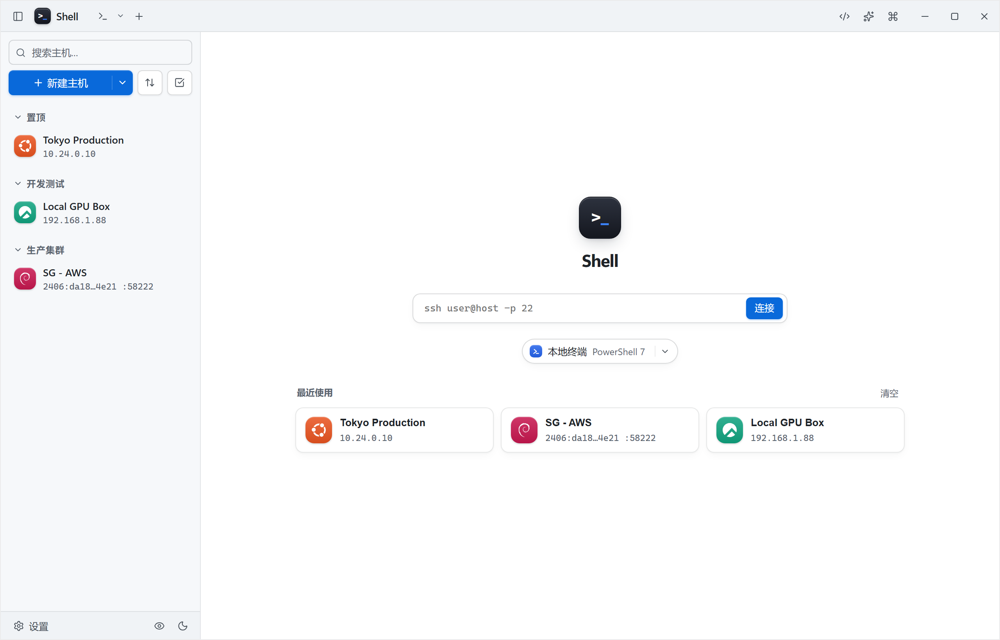
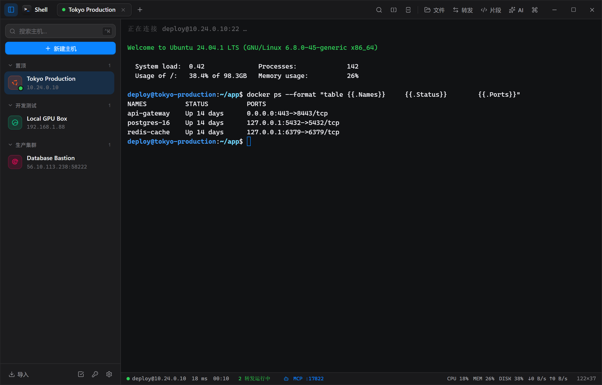
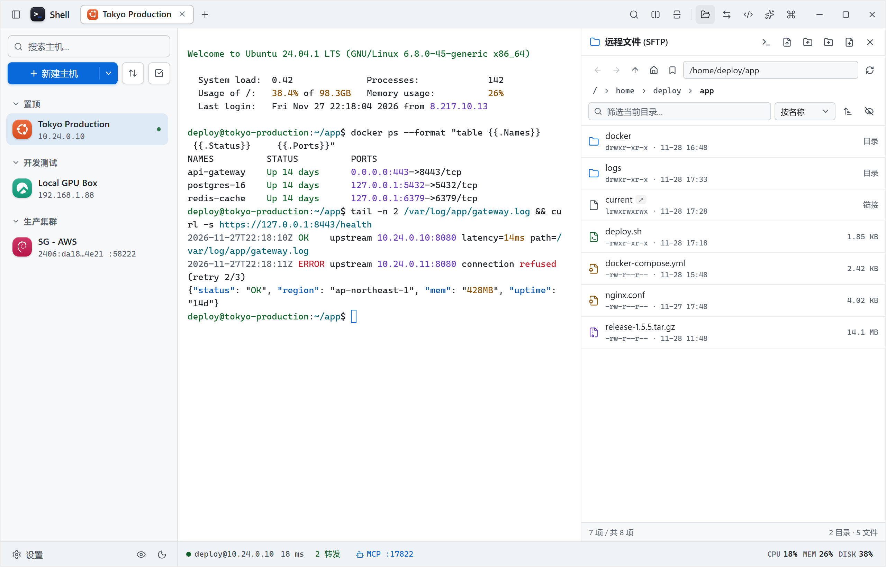
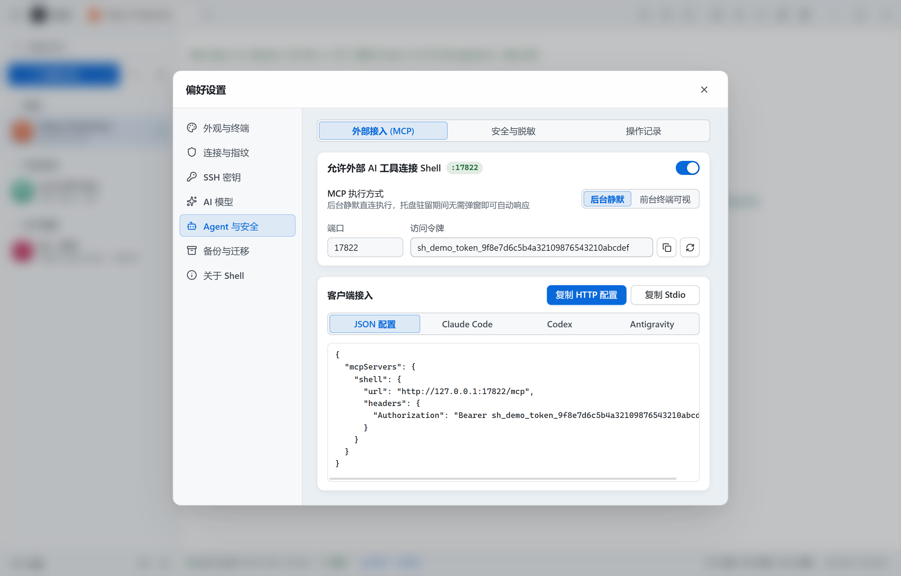

<div align="center">

# Shell

**面向 Windows 的轻量原生 SSH / SFTP 桌面客户端**

基于 Go 1.26、Wails v2 (WebView2) 与 xterm.js v6 构建，单文件便携分发（约 14 MB），无 Electron 运行时依赖。

[](https://github.com/haoch1/Shell/releases)
[](https://github.com/haoch1/Shell/actions/workflows/build.yml)
[](https://github.com/haoch1/Shell/releases)
[](https://go.dev/)
[](LICENSE)

[功能特性](#功能特性) · [下载安装](#下载安装) · [配置导入](#配置导入) · [AI 与 MCP 集成](#ai-与-mcp-集成) · [安全机制](#安全机制) · [源码构建](#源码构建) · [English](README_EN.md)

</div>

---

## 界面预览

<table>
  <tr>
    <td width="50%"></td>
    <td width="50%"></td>
  </tr>
  <tr>
    <td align="center"><sub>主机工作台与快速连接（浅色外观）</sub></td>
    <td align="center"><sub>多标签终端与状态栏监控（深色外观）</sub></td>
  </tr>
  <tr>
    <td width="50%"></td>
    <td width="50%"></td>
  </tr>
  <tr>
    <td align="center"><sub>侧边 SFTP 文件管理与远程编辑</sub></td>
    <td align="center"><sub>外部 MCP 接入、权限策略与自动脱敏</sub></td>
  </tr>
</table>

---

## 功能特性

### SSH 引擎与网络传输
- **认证机制**：支持密码、私钥（含口令解锁）、Windows OpenSSH Agent（`\\.\pipe\openssh-ssh-agent`）以及交互式键盘认证（2FA / OTP）。
- **多跳与网络路由**：支持最多 5 级 SSH 跳板机（`ProxyJump`）、SSH Agent 转发（`ForwardAgent`），支持全局及单机独立配置 **直连 / 跟随 Windows 系统代理（自动遵守 `ProxyOverride` 绕过规则）/ 自定义 SOCKS5 / HTTP `CONNECT`** 出站代理；导入主流客户端配置时自动关联跳板机与代理规则。
- **端口转发**：支持本地端口转发（`-L`）、远程端口转发（`-R`）与动态 SOCKS5 代理（`-D`），可按主机保存规则并配置连接后自动启动，实时统计连接数与字节流量。
- **连接维护**：支持心跳保活（KeepAlive）、往返延迟（RTT）测量、SSH 主机指纹校验（SHA-256 `known_hosts`）及登录后自动执行启动命令。

### 终端与工作区
- **低延迟终端引擎与连接诊断**：基于本机回环二进制 WebSocket 直通数据流（`TCP_NODELAY`、空闲零延迟即时回显与突发帧合并）和 xterm.js v6，自动协商 `COLORTERM=truecolor`，支持 Unicode 11 宽字符、URL 点击打开、OSC 7 工作目录追踪、静默无弹窗选区复制及可选 WebGL 硬件渲染；内置与外框无缝融合的校准深浅色终端主题（Termius Dark `#1C2028`）与基于 VT100/ANSI 状态机的终端实时语法高亮（自动着色提示符、IPv4、URL、JSON 键名、日志级别、路径与度量单位，兼容全屏 TUI 与已有 ANSI 色彩，可按需开关）；连接过程实时呈现内联步骤追踪（跳板机 / 建连 / 认证 / 会话就绪），失败时提供中文错误诊断、原始错误详情及一键重连/编辑配置。
- **多窗分屏、拖拽编排与独立拆分**：支持单标签内任意递归水平 / 垂直分屏（分屏时可选择已保存主机、当前主机或新建连接）、拖拽调节分屏比例、直接拖拽已连接会话标签或侧栏在线主机至目标终端边缘重排布局，支持将任意分屏子窗格一键「移出为独立标签页」并完整保留终端滚动历史，以及多窗格广播输入。
- **零抖动隐藏主机 IP 与克制状态指示**：侧边栏底栏与偏好设置内置一键 **隐藏主机 IP** 开关，开启后直接隐藏所有界面的 IP 与端口（不留明文 DOM、无占位圆点、锁定行高平滑过渡零跳动，适合演示、录屏与截图）；侧边栏以右侧极简圆点低调提示在线状态，已连接标签页保持干净克制。
- **高效交互与窗口持久化**：支持标签右键复制会话、向右/向下分屏、移出子窗格与关闭其他标签，`Ctrl+1..9` / `Ctrl+Tab` 切换标签，`Ctrl+Shift+F` 终端内正则搜索，`Ctrl+K` 全局命令面板；自动记忆上次窗口尺寸与最大化状态并自适应窗口缩放。
- **系统托盘**：支持关闭窗口时最小化至 Windows 系统托盘以保持端口转发与 MCP 服务后台运行；左键单击唤起主窗口，托盘右键菜单精简为「断开全部会话」与「退出 Shell」。

### 文件管理、监控与资产管理
- **专业级 SFTP 文件管理与 CodeMirror 6 远端编辑器**：文件抽屉支持左侧拖拽调节宽度、面包屑与历史前进/后退、按主机持久化的目录书签、虚拟化大目录列表（单次路径解析与按需符号链接查询）、多选（`Ctrl/Shift/Ctrl+A`）与完整右键菜单；支持文件夹递归上传/拖放与目录/批量下载、远端复制/移动、批量删除、3×3 可视化权限矩阵与递归 `chmod -R`、完整属性详情（含软链目标与 UID/GID）、实时速率传输队列及下载文件一键定位；内置基于 CodeMirror 6 的远端代码编辑器，提供 18 种语言与运维配置高亮、行号折叠、查找替换、自动换行、`LF/CRLF` 切换、深浅主题联动、未保存修改拦截与原子安全写入（保留原权限）。
- **零休眠服务器状态监控**：复用现有 SSH 连接无休眠采样远程 Linux 主机的 CPU、内存、磁盘、系统负载、运行时长与实时网络吞吐速率，并自动识别远程系统发行版图标（Ubuntu、Debian、CentOS、Rocky、Alpine、Arch、Fedora 等）。
- **主机与密钥管理**：支持主机分组及侧边栏分组上下手动拖拽排序并持久化、发行版图标与标记色、置顶排序、侧栏主机批量分组与批量删除、`known_hosts` 卡片表头全选/半选批量清理、内置丰富 Linux 运维命令的 `{{变量}}` 占位符片段库、本地 Ed25519 / RSA-4096 密钥生成与公钥一键部署（`~/.ssh/authorized_keys`）。
- **加密备份**：支持导出与恢复主机资料、命令片段与偏好设置；设置口令后采用 `AES-256-GCM` + `scrypt` 加密封装。

---

## 配置导入

在主界面侧边栏左下角点击 **导入图标按钮**，可直接拖入或多选配置文件，无需手动指定软件类型或目录。解析器自动识别格式并保留原始分组结构：

| 来源客户端 | 支持格式 / 文件扩展名 | 保留字段 |
| :--- | :--- | :--- |
| **Netcatty** | `.csv` | 主机（`Hostname/IP`）、端口、用户、加密凭据、代理、跳板机、标签、分组 |
| **Xshell** | `.xsh`（UTF-8 / UTF-16LE）、`.xts` / `.zip` 导出包 | 主机、端口、用户、备注、嵌套文件夹分组 |
| **MobaXterm** | `.mxtsessions` | 主机、端口、用户、私钥路径、`SubRep` 目录分组 |
| **Termius** | `.csv`、`.json` | 标签名、主机、端口、用户、分组 |
| **Tabby** | `.yaml` / `.yml` | 主机、端口、用户、私钥、跳板机、分组 |
| **Electerm** | `.json` | 书签列表及 `bookmarkGroups` 分组映射 |
| **SecureCRT** | `.xml` 导出文件、`.ini` 会话文件 | 主机、端口、用户、目录树分组 |
| **PuTTY / KiTTY** | `.reg` 注册表导出文件 | 会话名、主机、端口、用户、认证方式 |
| **WindTerm** | `user.sessions` | 标签名、主机、端口、用户、分组 |
| **FinalShell** | `.json` | 主机、端口、用户、备注 |
| **OpenSSH** | `~/.ssh/config`（一键扫描） | `Host`、`HostName`、`Port`、`User`、`IdentityFile`、`ProxyJump`、`ForwardAgent` |
| **通用格式** | `.csv`、`.json`、纯文本 `user@host:port` | 自动字段映射 |

### 导出服务器

点击侧边栏左下角导入图标右侧的 **导出图标按钮**，在固定尺寸的导出窗口中勾选目标主机（默认全选，支持一键全选 / 取消全选），统一导出为通用标准 **OpenSSH 配置文件**（上方「配置导入」仍完整支持导入 PuTTY `.reg` 等多平台配置）：

| 目标客户端 | 导出格式 | 如何使用 |
| --- | --- | --- |
| OpenSSH、VS Code Remote - SSH | OpenSSH 配置文件 | OpenSSH 可用 `ssh -F "文件路径" 主机别名` 直接连接；VS Code 可在 `remote.SSH.configFile` 中指定该文件。 |
| WinSCP、其他标准 SSH 客户端 | OpenSSH 配置文件 | 将需要的主机条目加入 `%USERPROFILE%\.ssh\config`，在「工具 → 导入站点」选择 OpenSSH（WinSCP 支持单级 `ProxyJump`）。[WinSCP 导入说明](https://winscp.net/eng/docs/ui_import) |

导出包含连接地址、端口、用户名、私钥路径及依赖的跳板机（`ProxyJump`）配置。密码、私钥口令和私钥内容始终保留在本机，不会写入导出文件；迁移到其他设备后请确认私钥文件路径。

---

## AI 与 MCP 集成

Shell 提供两种互补的 AI 协作方式，并统一纳入本地权限策略、脱敏引擎与审计日志管控：

### 1. 内置 AI 助手（自定义 API / 本地 CLI）
在 **偏好设置 → AI 模型** 中可自由切换两种调用模式（各本地 CLI 与 API 服务商独立记忆所选模型，互不串值）：
- **API 接口**：内置 **Claude、ChatGPT、Gemini、DeepSeek** 热门四家最新旗舰模型预设（`claude-sonnet-5-5` / `gpt-6.2-sol` / `gemini-4-neon` / `deepseek-flash`），提供可编辑模型下拉框与一键实时刷新可用模型列表（兼容 Anthropic、Gemini 原生与 OpenAI 格式接口及本地 Ollama），自动适配 Windows 系统代理。
- **本地 CLI**：自动检测并无弹窗无痕调用本机已安装的 **Claude Code (`claude`)**、**Codex CLI (`codex`)**、**Antigravity CLI (`agy`)** 或自定义命令行工具，直接复用现有 CLI 登录态且不向外部工具写入会话历史。

终端右侧 AI 助手采用直连式轻量对话流：
- **发送即排查执行**：输入需求按 `Enter` 即自主调用只读探测与运维工具完成排障，实时以紧凑可折叠步骤行展示执行过程与轻量 Markdown 代码块，并支持多轮对话上下文与终端选区一键分析。
- **SSH 与本机终端双目标直连**：自动感知当前活动的 SSH 会话或 Windows / WSL 本机终端，所有执行统一经过命令权限策略、高危操作弹窗确认、敏感信息自动脱敏与操作审计。

### 2. 外部 AI Agent 接入（MCP Server）
Shell 内置符合 MCP `2025-03-26` 规范的高性能本地桥接服务（跳板机连接池复用、认证后并行预热持久 SSH 命令通道、内存级配置与 `known_hosts` 缓存、Windows 命名管道本机自动发现、同资料并发连接共享握手与异步审计日志），默认监听 `127.0.0.1:17822`，支持 **Streamable HTTP**（`/mcp`）与 **stdio**（`Shell.exe --mcp`）两种传输方式，并提供 **JSON 配置 / Claude Code / Codex / Antigravity** 一键复制命令。支持切换 **后台静默（托盘极速执行）** 与 **前台终端可视（认证就绪立即放行、多行命令规整回显、结束后自动还原真实 Shell 提示符，支持取消）** 两种执行方式；AI 助手、本地 CLI 与外部 MCP 统一默认自动放行常规运维命令，仅真正毁灭性或高敏感系统操作触发确认弹窗，同时完整保留显式禁止规则与敏感路径保护。

在 **偏好设置 → Agent 与安全** 中开启后可一键复制接入配置：

```json
{
  "mcpServers": {
    "shell": {
      "url": "http://127.0.0.1:17822/mcp",
      "headers": {
        "Authorization": "Bearer <在偏好设置中复制的令牌>"
      }
    }
  }
}
```

完整工具列表（11 个标准 MCP Tool）、stdio 模式与 REST 接口说明请参阅 [docs/MCP.md](docs/MCP.md)。

---

## 安全机制

- **本地凭据加密**：SSH 密码、私钥口令、AI API 密钥与 MCP 认证令牌均通过 Windows DPAPI（`CryptProtectData`）加密存储于当前系统用户目录（`%LOCALAPPDATA%\Shell`），不以明文落盘。
- **结构化命令权限引擎**：将复合命令（`&&`、`||`、`;`、`|`、`$()`、反引号、输出重定向、`sudo` 包装）解析为独立子命令逐段评估，严格遵循 `禁止 > 审批 > 允许` 优先级，提供「只读 / 智能确认 / 每次确认 / 自动放行」四种全局策略及按主机独立覆盖。
- **自动文本脱敏**：在将终端输出、命令结果或远端文件内容返回给 AI 模型及外部 Agent 前，自动识别并替换 PEM 私钥、云厂商与常见 SaaS 密钥、JWT、HTTP 认证头、数据库连接串密码、`.env` 凭据以及邮箱、手机号、校验和验证的身份证号与 Luhn 银行卡号，支持自定义正则与豁免白名单。
- **SFTP 敏感路径拦截与审计**：默认禁止 Agent 访问 `/etc/shadow`、`*/.ssh/id_*`、`/proc/*/environ` 等敏感路径；所有外部 MCP 与内置 Agent 操作均以 JSONL 格式记录于 `%LOCALAPPDATA%\Shell\audit.jsonl`。

详细安全架构与漏洞报告流程请参阅 [SECURITY.md](SECURITY.md)。

---

## 下载安装

前往 [GitHub Releases](https://github.com/haoch1/Shell/releases) 下载最新版本：

| 发行文件 | 说明 |
| :--- | :--- |
| `Shell-Windows-x64.exe` | 单文件便携版，下载后直接双击运行 |
| `Shell-Windows-x64.zip` | 便携压缩包，包含可执行文件、说明文档与开源许可 |
| `SHA256SUMS.txt` | 发行产物 SHA-256 校验值 |

### 快速使用

打开 Shell，点击「新建主机」，填写地址、端口、用户名并选择密码、私钥或 SSH Agent 认证。连接后可从终端右上方打开 SFTP，或选择「左右分屏」「上下分屏」在同一标签中连接另一台主机。把已连接的标签拖到终端边缘可移动现有会话。

可在「设置 → 关于」查看当前版本，或在 PowerShell 中运行 `./Shell-Windows-x64.exe --version | Out-String`。安装包的版本应与下载页面的标签一致。

### 运行环境要求与更新升级
- **操作系统**：Windows 10（1903 及以上）或 Windows 11（x64）
- **运行依赖**：Microsoft Edge WebView2 Runtime（Windows 11 默认内置，Windows 10 缺失时自动引导安装）
- **应用内自动更新**：内置版本检测与无残留原地升级器（自动适配 Windows 系统代理），可在「偏好设置 → 关于 Shell」一键下载至用户目录并经 PE 头与 `SHA256SUMS.txt` 校验后，通过独立更新流程原子替换可执行文件并自动重启（在 `Program Files` 等受保护目录自动唤起原生 UAC 提权，正常升级不在安装目录残留 `.old` 文件）。
- **手动覆盖升级**：所有用户配置、主机列表、DPAPI 加密凭据、命令片段与审计日志均独立存放在 `%LOCALAPPDATA%\Shell`，不随程序目录存放。手动替换单文件 `.exe` 或便携 `.zip` 时，先在系统托盘右键选择 **退出 Shell** 后覆盖即可，全部数据与凭据完整保留。

### 常用快捷键

| 快捷键 | 功能 | 快捷键 | 功能 |
| :--- | :--- | :--- | :--- |
| `Ctrl+K` | 打开全局命令面板 | `Ctrl+Shift+F` | 终端内搜索 |
| `Ctrl+N` | 新建 SSH 主机 | `Ctrl+Shift+A` | 打开 / 关闭 AI 助手 |
| `Ctrl+B` | 显示 / 隐藏侧边栏 | `Ctrl+Shift+C / V` | 终端复制 / 粘贴 |
| `Ctrl+,` | 打开偏好设置 | `Ctrl+1..9` / `Ctrl+Tab` | 切换会话标签 |
| `Ctrl+W` | 关闭当前标签页 | `Ctrl+ + / - / 0` | 调整 / 重置终端字号 |

---

## 源码构建

构建依赖：**Go 1.26+**（`CGO_ENABLED=0`）、**Node.js 22+**、Windows x64 环境。

```powershell
# 1. 构建前端静态资源
cd frontend
npm ci
npm run build
cd ..

# 2. 运行全部 Go 单元测试与集成测试
$env:CGO_ENABLED = '0'
go test -v -count=1 -tags desktop,production,wv2runtime.download ./...

# 3. 编译并打包 Windows x64 便携可执行文件与校验和
./.github/scripts/package-windows.ps1

# 4. 执行原生 WebView2 启动校验与端到端 UI 测试
node .github/scripts/smoke-windows.mjs
```

每次功能迭代在 `frontend` 目录用 `npm version minor --no-git-tag-version` 更新版本和锁文件。仅修复问题时使用 `patch`。在 `CHANGELOG.md` 增加对应版本说明后，CI 会从 `frontend/package.json` 读取版本并检查发布标签。

### 目录结构

```text
Shell/
├── main.go                     # 程序入口（Wails v2 桌面窗口、窗口状态恢复与 --mcp stdio 桥接）
├── app.go                      # 桌面端 RPC 绑定、窗口生命周期与会话管理
├── term_ws.go                  # 纯 Go 本机回环二进制 WebSocket 终端数据流服务
├── tray_windows.go             # 纯 Go Windows 原生系统托盘与精简右键菜单
├── agent_runtime.go            # MCP / AI 工具调度、交互审批与通用导入绑定
├── cmd/genrsrc/                # 纯 Go Windows 图标与 COFF 资源 (.syso) 生成器
├── internal/
│   ├── local/                  # 主机配置、DPAPI 凭据、通用导入器、片段、密钥、保险库、AI 客户端
│   ├── remote/                 # SSH 会话、ProxyJump、SOCKS5/HTTP 代理、SFTP、端口转发、状态监控
│   ├── security/               # 敏感信息脱敏引擎、结构化命令策略引擎、JSONL 审计日志
│   └── agentbridge/            # MCP Streamable HTTP (JSON-RPC 2.0) 服务端、REST API 与 stdio 代理
├── frontend/                   # React 19 + TypeScript + Vite 6 + xterm.js v6 前端工程
└── .github/                    # GitHub Actions 自动化测试、打包与 Release 流水线
```

---

## 相关文档与开源许可

- [MCP 协议与外部 Agent 接入文档](docs/MCP.md)
- [安全策略与架构说明](SECURITY.md)
- [版本变更记录](CHANGELOG.md)
- [参与贡献指南](CONTRIBUTING.md)
- 本项目基于 [MIT License](LICENSE) 开源发布。
