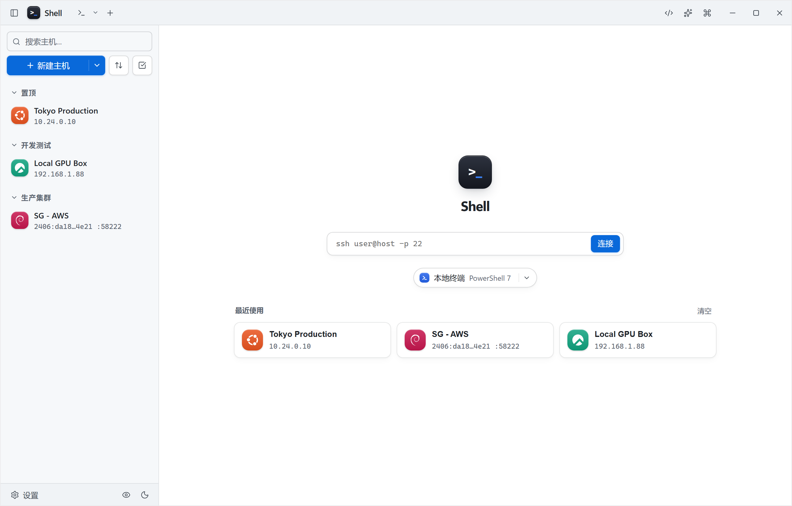
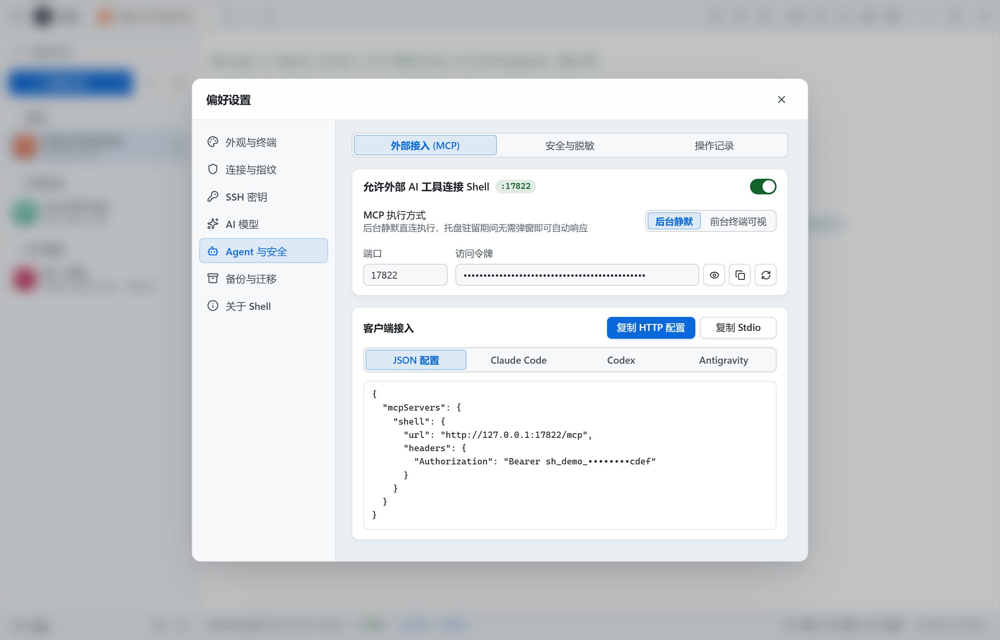

<div align="center">

# Shell

**Lightweight Native Windows SSH / SFTP Desktop Client**

Built with Go 1.26, Wails v2 (WebView2), and xterm.js v6. Distributed as a single portable executable (~14 MB) with no Electron runtime.

[](https://github.com/haoch1/Shell/releases)
[](https://github.com/haoch1/Shell/actions/workflows/build.yml)
[](https://github.com/haoch1/Shell/releases)
[](https://go.dev/)
[](LICENSE)

[简体中文](README.md) · [MCP Guide](docs/MCP.md) · [Security](SECURITY.md) · [Changelog](CHANGELOG.md) · [Releases](https://github.com/haoch1/Shell/releases)

</div>

---

## Screenshots

<table>
  <tr>
    <td width="50%"></td>
    <td width="50%"></td>
  </tr>
  <tr>
    <td width="50%"></td>
    <td width="50%"></td>
  </tr>
</table>

---

## Features

- **SSH Engine & Routing**: Password, private key (encrypted/unencrypted), Windows OpenSSH Agent, keyboard-interactive 2FA, up to 5-hop `ProxyJump`, `ForwardAgent`, global & per-host **Direct / Windows System Proxy (with `ProxyOverride` bypass) / SOCKS5 / HTTP `CONNECT`** routing, KeepAlive, RTT latency measurement, and SHA-256 `known_hosts` verification.
- **Terminal & Workspace**: Low-latency loopback binary WebSocket terminal powered by xterm.js v6 with optional WebGL acceleration, paired light/dark terminal themes synced to the daylight-readable UI appearance, recursive horizontal/vertical split panes, broadcast input, regex search (`Ctrl+Shift+F`), command palette (`Ctrl+K`), OSC 7 working-directory tracking, window bounds persistence, and native Windows system tray minimization.
- **SFTP, Port Forwarding & Telemetry**: Integrated SFTP browser with drag-and-drop uploads, progress queue, `chmod`, remote text editor; Local (`-L`), Remote (`-R`), and dynamic SOCKS5 (`-D`) tunnels; zero-sleep Linux CPU/RAM/disk/network telemetry with OS distro detection; Ed25519/RSA-4096 key generator; AES-256-GCM + scrypt vault backup.
- **Universal Config Importer**: Auto-detects exports from Netcatty (`.csv`), Xshell (`.xsh`/`.xts`/`.zip`), MobaXterm (`.mxtsessions`), Termius (`.csv`/`.json`), Tabby (`.yaml`), Electerm (`.json`), SecureCRT (`.xml`/`.ini`), PuTTY/KiTTY (`.reg`), WindTerm, FinalShell, OpenSSH `config`, and generic CSV/JSON/text while preserving groups, credentials, jump hosts, and proxy settings.
- **AI Assistant & MCP Server**: Built-in presets for Claude, ChatGPT, Gemini, and DeepSeek (with Windows system proxy support) plus local AI CLIs (Claude Code, Codex CLI, Antigravity CLI `agy`); high-speed persistent-channel MCP `2025-03-26` server (Streamable HTTP `127.0.0.1:17822/mcp` and stdio `Shell.exe --mcp`) with **Silent Background (Tray)** and **Visible Terminal** execution modes, command policy governance, automatic secret/PII redaction, and JSONL audit logging.
- **In-App Auto-Update**: Built-in version checker and one-click in-app self-updater with mandatory `SHA256SUMS.txt` verification and atomic binary swap.

---

## Build from Source

The Windows build reads its version from `frontend/package.json`. To check the installed binary, open Settings → About or run `./Shell-Windows-x64.exe --version | Out-String` in PowerShell.

Requires Go 1.26+ (`CGO_ENABLED=0`) and Node.js 22+ on Windows x64.

```powershell
cd frontend && npm ci && npm run build && cd ..
$env:CGO_ENABLED = '0'
go test -v -count=1 -tags desktop,production,wv2runtime.download ./...
./.github/scripts/package-windows.ps1
node .github/scripts/smoke-windows.mjs
```

---

## License

Licensed under the [MIT License](LICENSE).
