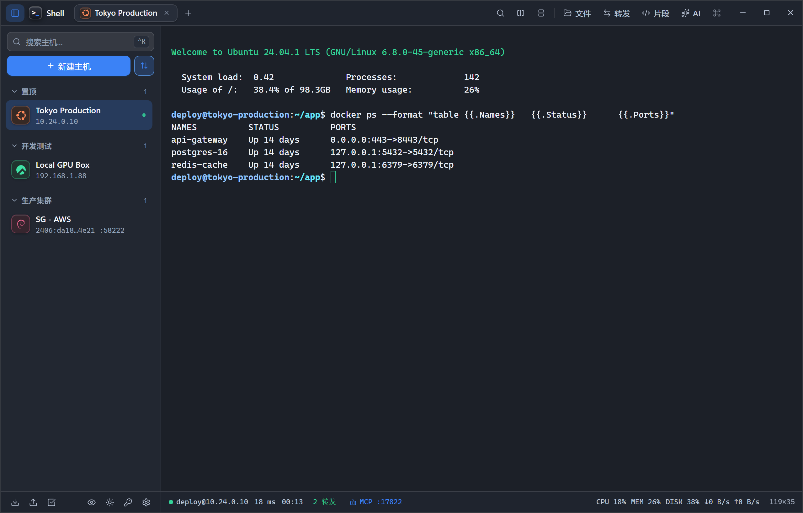
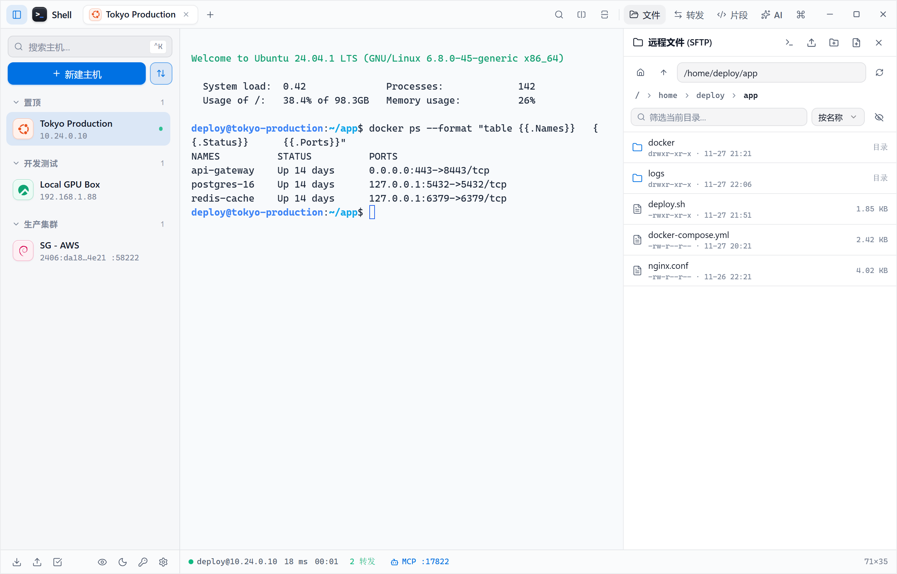

<div align="center">

# Shell

**Lightweight Native Windows SSH / SFTP Desktop Client**

Built with Go 1.26, Wails v2 (WebView2), and xterm.js v6. Distributed as a single portable executable (~14 MB) with no Electron runtime.

[](https://github.com/haoch1/Shell/releases)
[](https://github.com/haoch1/Shell/actions/workflows/build.yml)
[](https://github.com/haoch1/Shell/releases)
[](https://go.dev/)
[](LICENSE)

[简体中文](README.md) · [MCP Guide](docs/MCP.md) · [Security](SECURITY.md) · [Changelog](CHANGELOG.md) · [Releases](https://github.com/haoch1/Shell/releases)

</div>

---

## Screenshots

<table>
  <tr>
    <td width="50%"></td>
    <td width="50%"></td>
  </tr>
  <tr>
    <td width="50%"></td>
    <td width="50%"></td>
  </tr>
</table>

---

## Features

- **SSH Engine & Routing**: Password, private key (encrypted/unencrypted), Windows OpenSSH Agent, keyboard-interactive 2FA, up to 5-hop `ProxyJump`, `ForwardAgent`, global & per-host **Direct / Windows System Proxy (with `ProxyOverride` bypass) / SOCKS5 / HTTP `CONNECT`** routing, KeepAlive, RTT latency measurement, and SHA-256 `known_hosts` verification.
- **Terminal & Workspace**: Low-latency loopback binary WebSocket terminal powered by xterm.js v6 with optional WebGL acceleration, paired light/dark terminal themes synced to the daylight-readable UI appearance, recursive horizontal/vertical split panes (pick a saved host, current host, or new connection, drag live tabs / sidebar sessions to pane edges, or detach any split pane into a standalone tab while preserving terminal scrollback), broadcast input, regex search (`Ctrl+Shift+F`), command palette (`Ctrl+K`), OSC 7 working-directory tracking, ultra-quiet online status indicators, window bounds persistence, and native Windows system tray minimization.
- **Host IP Privacy Mode**: One-click persistent **Hide Host IP** toggle in the sidebar footer (and Preferences → Appearance) cleanly omits IPv4, IPv6, hostnames, and custom ports from the DOM across the sidebar, welcome screen, tabs, split headers, status bar, command palette, and export dialog with fixed row/card heights and smooth CSS transitions (zero dots, zero blur, zero layout shift) for clean screen-sharing and screenshots while keeping copy-address convenient.
- **SFTP, Port Forwarding & Telemetry**: Integrated SFTP browser with virtualized large-directory rendering (single path resolve & on-demand symlink resolution), concurrent large-file transfers, atomic safe writes, drag-and-drop uploads, progress queue, `chmod`, and remote text editor; Local (`-L`), Remote (`-R`), and dynamic SOCKS5 (`-D`) tunnels; zero-sleep Linux CPU/RAM/disk/network telemetry with OS distro detection; batch host grouping and batch deletion in the sidebar; rich built-in Linux snippet library; Ed25519/RSA-4096 key generator; AES-256-GCM + scrypt vault backup.
- **Universal Config Importer & Unified OpenSSH Export**: Compact icon-only **Import** and **Export** buttons in the bottom-left sidebar footer. Auto-detects imports from Netcatty (`.csv`), Xshell (`.xsh`/`.xts`/`.zip`), MobaXterm (`.mxtsessions`), Termius (`.csv`/`.json`), Tabby (`.yaml`), Electerm (`.json`), SecureCRT (`.xml`/`.ini`), PuTTY/KiTTY (`.reg`), WindTerm, FinalShell, OpenSSH `config`, and generic CSV/JSON/text while preserving groups, credentials, jump hosts, and proxy settings. Simplified fixed-size **Host Export** modal with select-all exports selected hosts directly to a standard **OpenSSH config** file (including `ProxyJump` dependencies, ready for OpenSSH, VS Code Remote - SSH, and WinSCP) while keeping passwords and private key contents strictly on the local machine.
- **AI Assistant & High-Speed MCP Server**: Built-in latest flagship presets for Claude (`claude-sonnet-5-5`), ChatGPT (`gpt-6.2-sol`), Gemini (`gemini-4-neon`), and DeepSeek (`deepseek-flash`) with an editable model combobox and one-click live model list refresh (supporting Anthropic, Gemini native/OpenAI-compat, OpenAI, DeepSeek, Ollama, and custom relays via Windows system proxy) plus local AI CLIs (Claude Code, Codex CLI, Antigravity CLI `agy`); high-speed MCP `2025-03-26` server with ProxyJump client pooling/reuse, parallel warm `sh -s` exec workers, early-ready visible handoffs, fast AEAD/KEX preference, in-memory `known_hosts`/profile caches, Streamable HTTP (`127.0.0.1:17822/mcp`), Windows named-pipe stdio (`Shell.exe --mcp`), **Silent Background (Tray)** and **Visible Terminal** execution modes, command policy governance, automatic secret/PII redaction, and JSONL audit logging.
- **Resilient Zero-Leftover In-App Auto-Update**: Built-in version checker and self-updater that stages and verifies PE headers + `SHA256SUMS.txt` in `%LOCALAPPDATA%\Shell\updates\`, performs clean detached atomic replacement via `--apply-update` (with native Windows UAC elevation for protected directories such as `Program Files`), leaves zero `.old` files behind, and cleans up legacy leftovers automatically.

---

## Build from Source

The Windows build reads its version from `frontend/package.json`. To check the installed binary, open Settings → About or run `./Shell-Windows-x64.exe --version | Out-String` in PowerShell.

Requires Go 1.26+ (`CGO_ENABLED=0`) and Node.js 22+ on Windows x64.

```powershell
cd frontend && npm ci && npm run build && cd ..
$env:CGO_ENABLED = '0'
go test -v -count=1 -tags desktop,production,wv2runtime.download ./...
./.github/scripts/package-windows.ps1
node .github/scripts/smoke-windows.mjs
```

---

## License

Licensed under the [MIT License](LICENSE).
